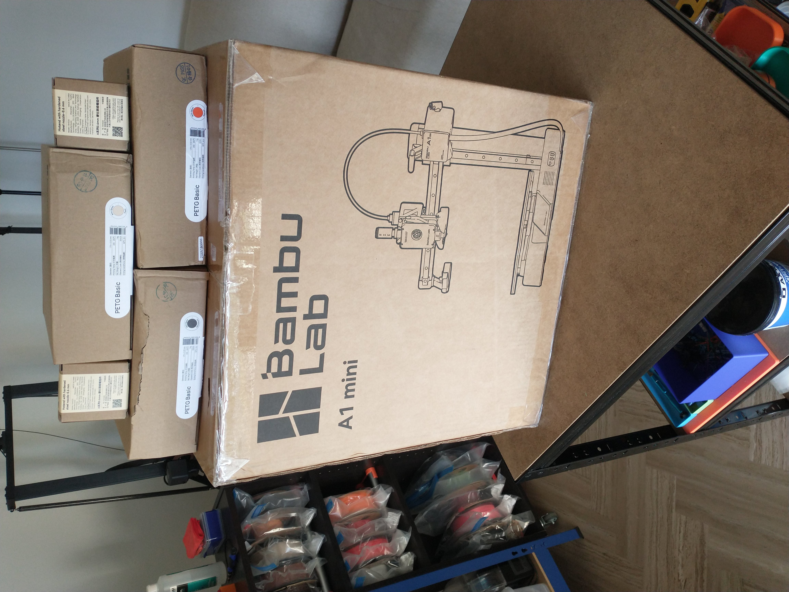

I took advantage of last week’s sales on the [Bambu Lab](https://bambulab.com/it-it) website and bought an [A1 Mini](https://bambulab.com/it-it/a1-mini).

I’d been wanting to try it for a long time, given all the positive reviews since it hit the market.

I went with the version without the multi-color system because I wanted a high-performance printer that didn’t take up much space, and I find the A1 Mini’s multi-color system to be quite bulky.

It arrived a few days ago.

Of the various reviews on YouTube, I chose the one by [Arne Bornheim](https://www.arnebornheim.com/) because it specifically describes the non-multicolor version.

Bambu Lab A1 mini review by Arne Bornheim

ooOOoo