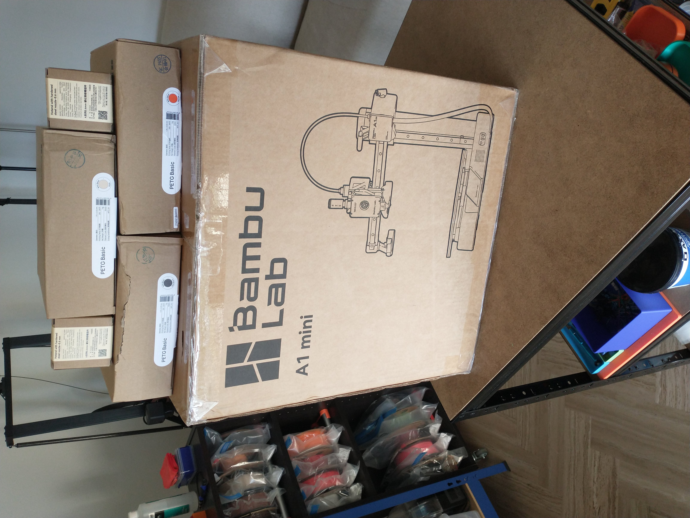

Ho approfittato degli sconti della settimana scorsa sul sito [Bambu Lab](https://bambulab.com/it-it) e ho acquistato una [A1 Mini](https://bambulab.com/it-it/a1-mini).

Era da tanto che la volevo provare visto le tante recensioni positive da quando è uscita sul mercato.

Ho preso la versione senza il sistema multi-colore perchè volevo una stampante performante ma con un ingombro ridotto e il sistema multi-colore della A1 mini lo trovo decisamente ingombrante.

Qualche giorno fa è arrivata.

Delle varie recensioni presenti su YouTube ho scelto quella realizzata da [Andrea Galeazzi](https://andreagaleazzi.com/) perchè descrive proprio la versione senza multi-colore.

Recensione Bambu Lab A1 mini di Andrea Galeazzi

ooOOoo