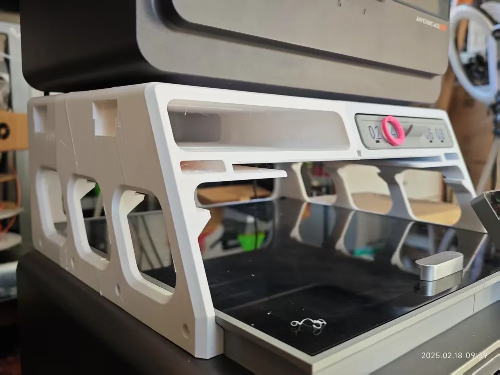
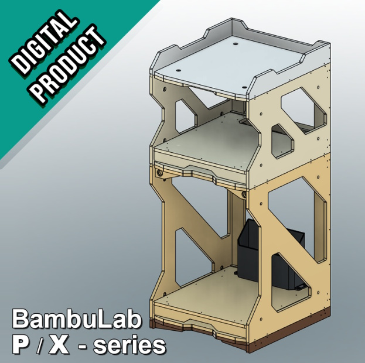
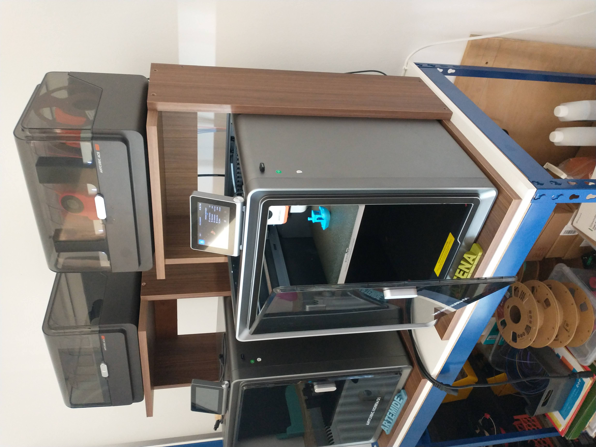
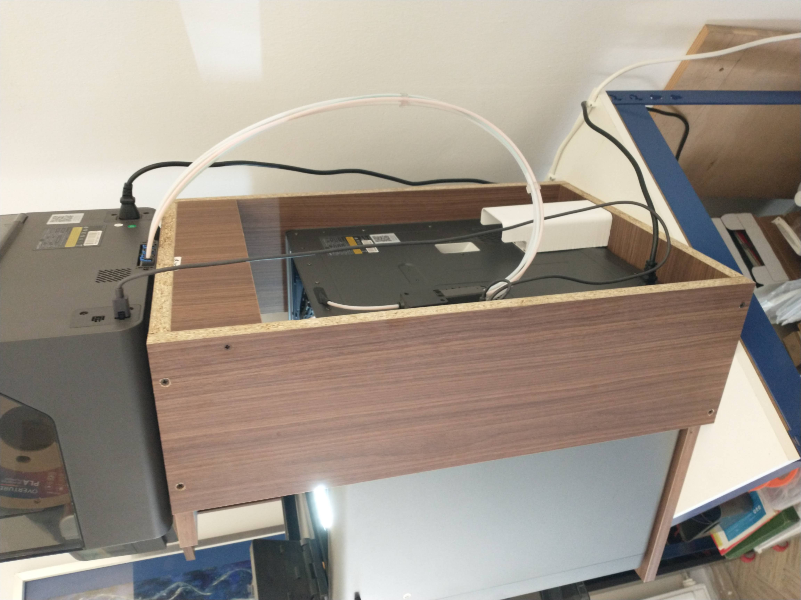

I often need to remove the printer cover to let it “breathe” or to easily access the print head for maintenance. And that means I have to move the ACE Pro somewhere else.

Ideally, the ACE Pro should be raised above the printer to allow room to maneuver without having to move the multicolor device.

I looked into a solution I found on [MakerWorld](https://makerworld.com/it/models/1121877-vertical-cube-s1c-heightening-component), but it takes nearly 4 days to print and uses about 2 kg of filament, so it's not quite what I was looking for.

Then I came across a very interesting project created by [PeteSquared](https://www.petesquared23.com/) using a laser engraver.

But I don't have a laser engraver, and there aren't any service providers nearby that I can turn to.

So I thought about how to build a structure that would meet my needs using what I had on hand.

The printer is 40 cm wide, so I started with a 40 x 100 cm veneered particleboard panel from a local hardware store.

I had two panels cut so I could assemble the first version of the structure.

Side panels 70 cm high, with a 30 cm multicolor shelf and a 40x50 cm base. Plus a 40x10 cm piece used on the back of the tall shelf to keep the structure square.

I’m satisfied with the result but aware that I need two of these structures, so that was version one.

Version two underwent a couple of changes. Side panels 65 cm tall, a 26 cm shelf for the multicolor filament (though it could have been 25 cm and the multicolor filament still fit), and the base still measuring 40x50 cm. A scrap piece measuring 40x10 cm was used to keep the structure square.

And that brings me to version two of the structure, which I find more compact (even though I’m tall, the extra five cm from version one caused me some trouble when loading the filament spools).

On the left is the first version, and on the right is version two, which will be the final version.

Resting on a white veneered surface, the structure can be moved and rotated to allow access from the rear for maintenance.

I'm very pleased with the results. It's making my work a lot easier.

The Kobra S1 prints well, but every now and then it has trouble handling the filament when it runs out, and I have to turn the printer over and use a screwdriver and an Allen wrench to fix it.

ooOOoo