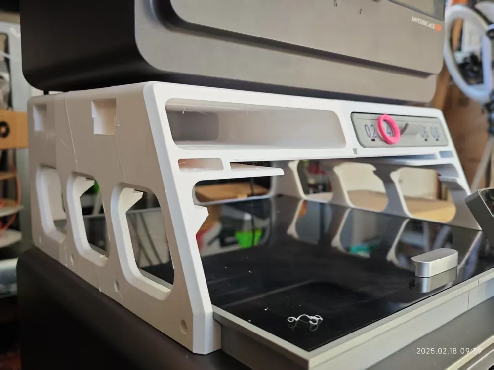
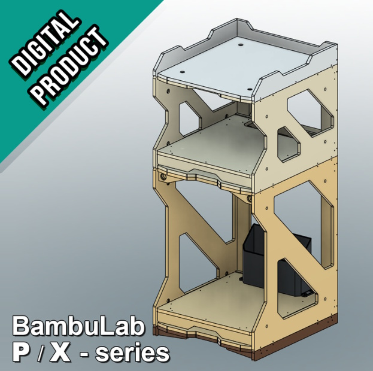
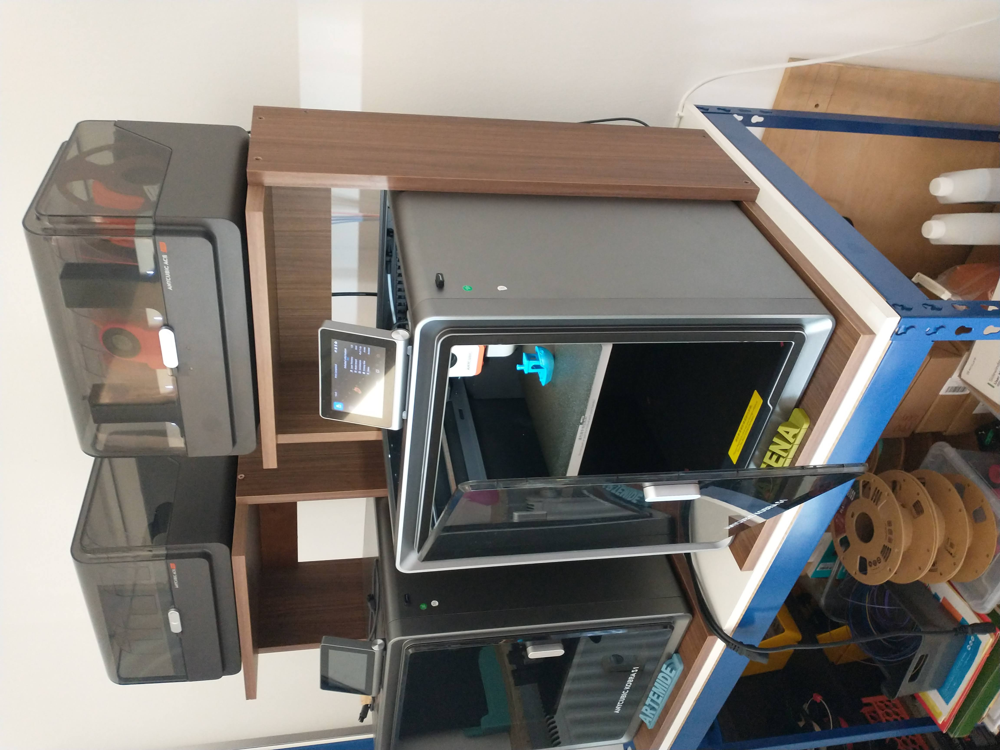
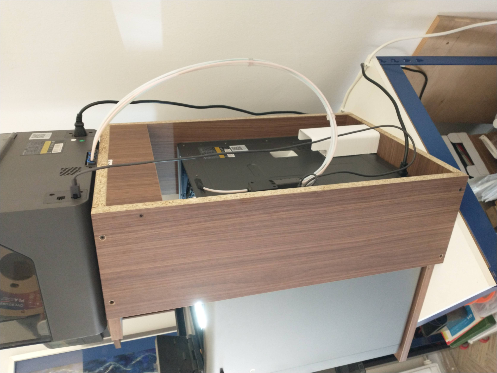

Mi capita spesso di aver bisogno di togliere il coperchio della stampante per farla respirare o per accedere facilmente alla testina di stampa per manutenzione. Ed è necessario spostare l'ACE pro da qualche parte.

L'ideale sarebbe che l'ACE Pro fosse sollevato rispetto alla stampante per lasciare spazio di manovra senza dover spostare il dispositivo del multicolore.

Ho valutato una soluzione trovata su [MakerWorld](https://makerworld.com/it/models/1121877-vertical-cube-s1c-heightening-component), ma richiede quasi 4 giorni di stampa e circa 2 kg di filamento e non è proprio la soluzione che cercavo.

Poi ho trovato un progetto molto interessante realizzato da [PeteSquared](https://www.petesquared23.com/) utilizzando un incisore laser.

Ma non ho l'incisore laser e nessun service nelle vicinanze a cui rivolgermi.

Così ho pensato a come realizzare una struttura che soddisfi la mia esigenza con quello che ho a disposizione.

La stampante è larga 40cm e quindi sono partito da un pannello di trucciolare impiallacciato da 40x100cm tra quelli disponibili in un Brico locale.

Ho fatto tagliare due pannelli per arrivare ad assemblare la prima versione della struttura. 

Fianchetti alti 70cm, con il ripiano del multicolore da 30cm e la base 40x50cm. Oltre ad un pezzo da 40x10cm utilizzato sul dietro del ripiano alto per tenere in squadra la struttura.

Soddisfatto del risultato ma consapevole che me ne servono due di strutture e quindi quella era la versione uno.

La versione due ha subito un paio di modifiche. Fianchetti altri 65cm, ripiano per il multicolore da 26cm (ma potevano essere anche 25cm e il multicolore ci stava comunque) e la base ancora da 40x50cm. Un pezzo di scarto da 40x10cm utilizzato per tenere in squadra la struttura. 

E sono arrivato alla versione due della struttura che trovo più compatta (anche se sono alto, i cinque cm in più della versione uno mi creavano qualche problema a caricare le bobine del filamento).

A sinistra la prima versione e a destra la versione due che sarà la definitiva.

Appoggiata su piano impiallacciato bianco, è possibile lo spostamento e la rotazione della struttura per accedere posteriormente per manutenzione.

Sono molto soddisfatto del risultato ottenuto. Mi sta semplificando molto il lavoro.

La Kobra S1 stampa bene ma ogni tanto inciampa sulla gestione del filamento quando finisce ed è necessario girarla e usare cacciavite e brugola per risolvere.

ooOOoo