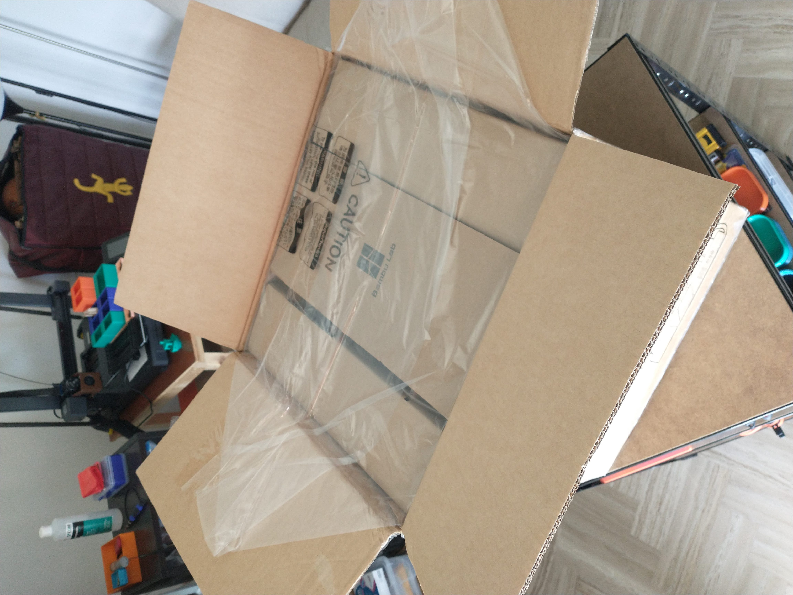
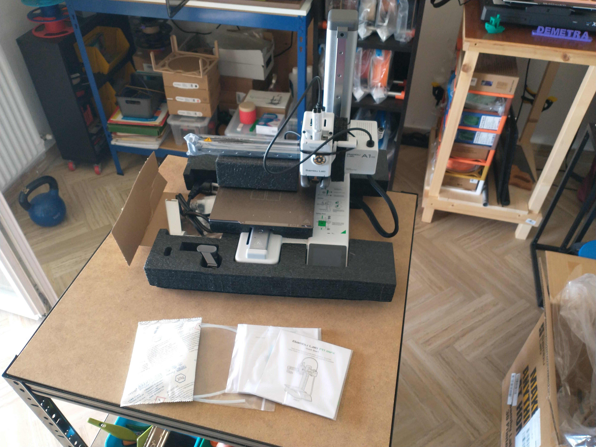
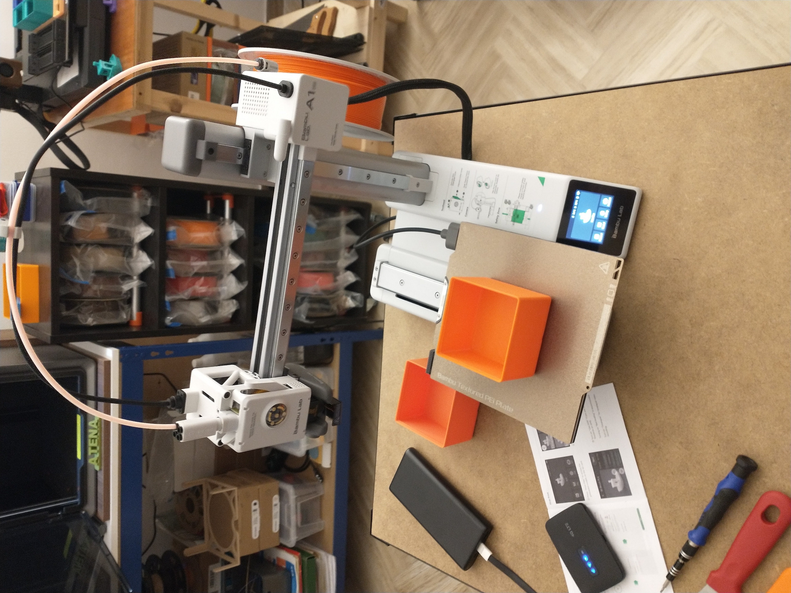

I would have liked to make an unboxing video of the printer, but the test runs I did didn't turn out very well.

So I'll show you the package right after I've opened it:

then the printer, still with some of the packaging on it:

And finally, the printer is up and running — it has completed a box from the [Gridfinity](https://gridfinity.xyz/) series, with the same box printed on the Anycubic Kobra S1 next to it for a print quality comparison.

Print made from PETG by [Bambu Studio](https://bambulab.com/en/download/studio) using the default settings.

Anyway, this video is the shortest unboxing I've ever seen for the Bambu Lab A1 mini 😄

Bambu Lab A1 mini - unboxing and print in 60 seconds

I'm planning to build a suitable cabinet for this little gem of a printer soon.

ooOOoo