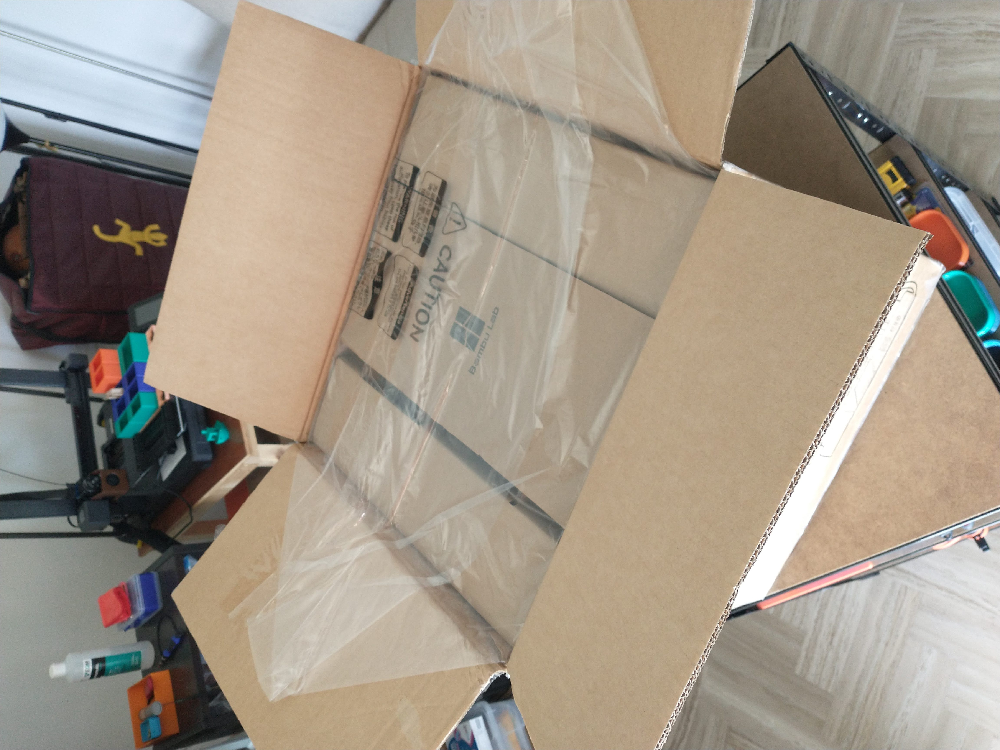
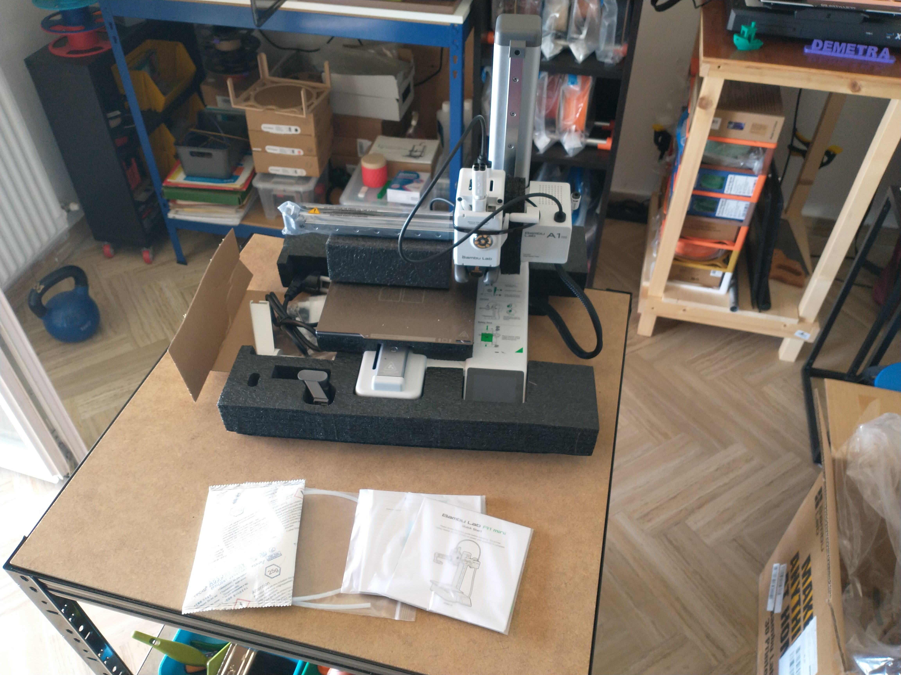
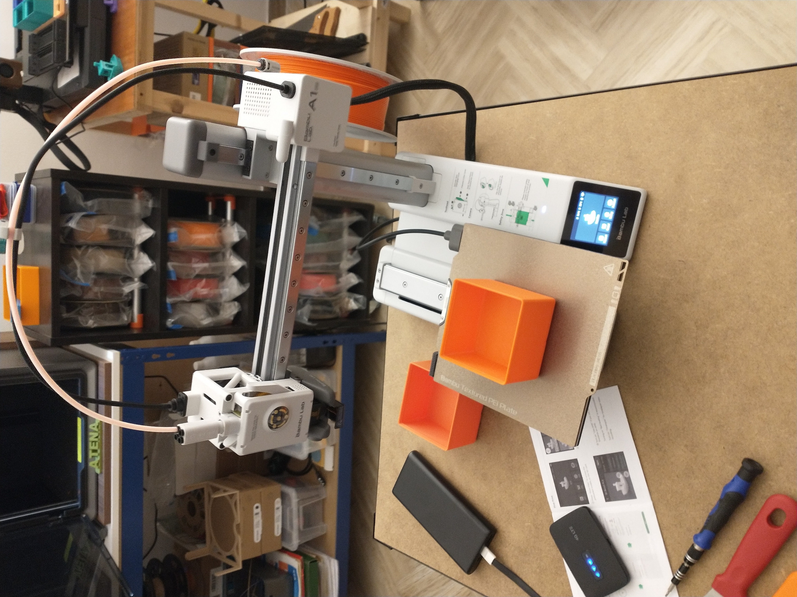

Mi sarebbe piaciuto fare un video sull'unboxing della stampante, ma le prove che ho fatto non sono venute un granchè bene.

Quindi mostrerò il pacco appena aperto:

poi la stampante con ancora alcune parti dell'imballaggio:

E alla fine la stampante finalmente operativa che ha completato una scatola della serie [Gridfinity](https://gridfinity.xyz/) con a fianco la stessa scatola stampata con la Anycubic Kobra S1 per confrontare la qualita di stampa.

Stampa realizzata in PETG tramite [Bambu Studio](https://bambulab.com/en/download/studio) con la configurazione di default.

Comunque questo video è l'unboxing più sintetico che abbia mai visto sulla Bambu Lab A1 mini 😄

Bambu Lab A1 mini - unboxing and print in 60 seconds

Prossimamente ho intenzione di preparare un mobiletto adeguato per questo gioiellino di stampante.

ooOOoo