Il titolo è fuorviante, perchè ho già un'installazione attiva di Proxmox su ThinkCentre M900 Tiny, versione 8.4.19. Ma mi viene segnalato che il supporto per Proxmox VE 8 termina il 2026-08-31, cioè la fine di agosto 2026. E ho pensato di approfittare di questa occasione per installare una versione più recente di Proxmox VE su quella macchina.

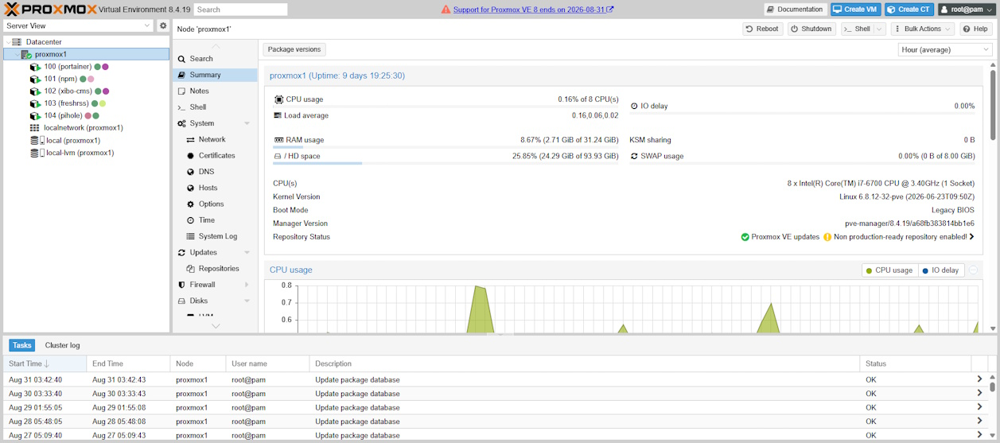

## Cos'è Proxmox VE?
 
Per chi non ne fosse a conoscenza, [Proxmox Virtual Environment (Proxmox VE)](https://proxmox.com/en/products/proxmox-virtual-environment/overview) è una piattaforma completa e open-source per la gestione di server e la virtualizzazione aziendale. Integra in un'unica piattaforma l'hypervisor KVM e i container Linux (LXC), lo storage software-defined e le funzionalità di rete. Grazie all'interfaccia utente web integrata, è possibile gestire con facilità macchine virtuali e container, garantire l'alta disponibilità dei cluster e utilizzare gli strumenti integrati per il disaster recovery.

È scaricabile gratuitamente, ben documentata, e nonostante sia di classe enterprise viene molto utilizzata anche nell'ambiente homelab.
 
La versione corrente è la 9.2 e la relativa ISO è disponibile [qui](https://proxmox.com/en/downloads/proxmox-virtual-environment/iso).
 
## L'hardware: Lenovo ThinkCentre M900 Tiny

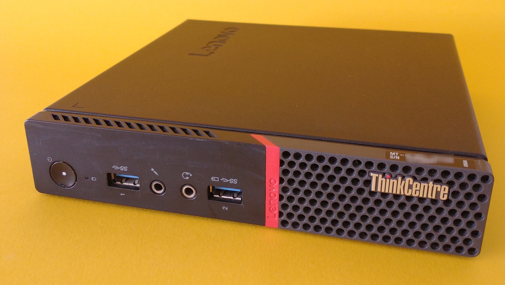

Il ThinkCentre M900 Tiny è un mini PC di classe business prodotto da Lenovo qualche anno fa. Le sue caratteristiche principali:
 
- **CPU:** Intel Core i7-6700T (4 core / 8 thread)
- **RAM:** 32Gb DDR4-2133
- **SSD:** M.2 2280 PCIe Gen3x4 NVMe da 1Tb
- **Form factor:** ultra-compatto (tiny/mini PC)
- **Compatibilità:** ottima con Linux e con le tecnologie di virtualizzazione Intel (VT-x e VT-d supportate)

Per maggiori informazioni esiste [questa guida](https://www.servethehome.com/lenovo-thinkcentre-m900-tiny-project-tinyminimicro-guide/) a cura di [Patrich Kennedy](https://www.servethehome.com/author/patrick/) di [ServeTheHome](https://www.servethehome.com/).


## Cosa serve prima di iniziare
 
- Una chiavetta USB da almeno **2 GB**, io ne ho utilizzata una da 8 Gb
- Un PC su cui preparare la chiavetta (Windows, macOS o Linux vanno bene)
- La ISO di Proxmox VE scaricata dal [sito ufficiale](https://proxmox.com/en/downloads/proxmox-virtual-environment/iso)
- Il software [Rufus](https://rufus.ie/it/) per scrivere la ISO sulla chiavetta
- Un monitor e una tastiera da collegare temporaneamente al ThinkCentre
- Una connessione di rete via cavo Ethernet (consigliata per l'installazione)
 
## Step 1 — Scaricare la ISO di Proxmox VE
 
Dal [sito ufficiale](https://proxmox.com/en/downloads/proxmox-virtual-environment/iso) di Proxmox ho scaricato l'immagine ISO della versione 9.2.
 
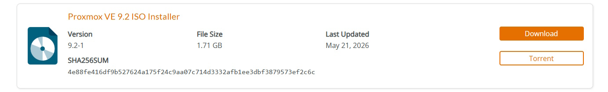
 
 
## Step 2 — Creare la chiavetta USB avviabile
 
Per scrivere la ISO sulla chiavetta USB ho usato [Rufus](https://rufus.ie/it/), un tool gratuito e semplice da utilizzare disponibile per Windows:
 
1. Scaricare Rufus e lanciare l'eseguibile (non richiede installazione)
2. Selezionare la chiavetta USB come destinazione, nel mio caso USB-KEY da 8 Gb
3. Selezionare la ISO di Proxmox VE
4. Rufus rileva un'immagine "ibrida" e quindi scrive la ISO con DD
5. Cliccare su **Avvia** o **Start**
6. Rufus comunica che tutti i dati sulla chiavetta USB saranno cancellati
7. Premendo OK si avvia l'operazione di scrittura


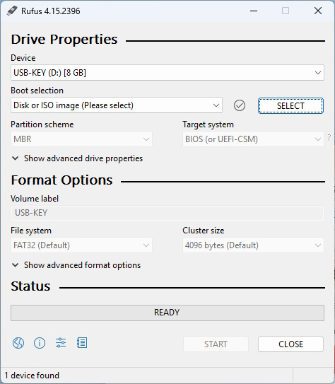


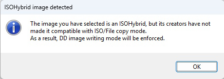


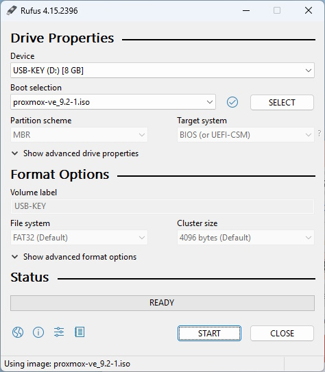


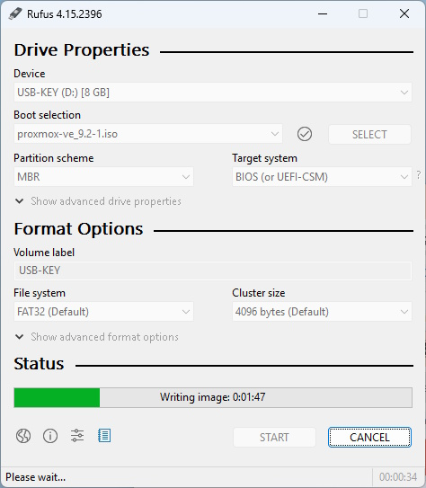


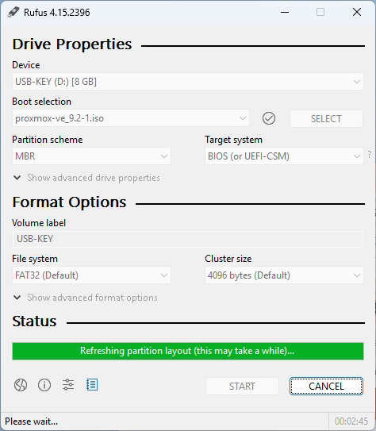


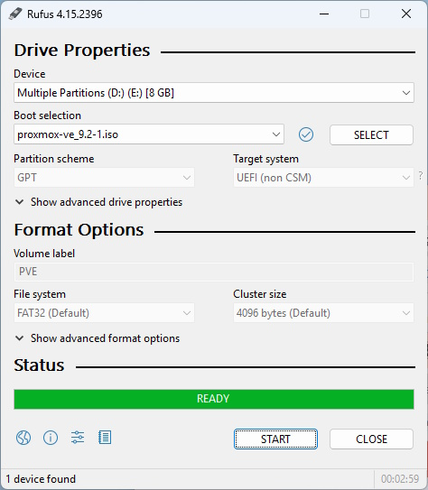


## Step 3 — Modifiche al BIOS (virtualizzazione e sequenza di boot)
 
Ho inserito la chiavetta USB con la ISO di Proxmox, collegato monitor e tastiera, inserito il cavo di rete e acceso il ThinkCentre M900 Tiny. Premendo il tasto `F1` si può accedere al menu di boot.

Due sono le cose da controllare ed eventualmente modificare:
- il device di boot che deve essere **USB KEY**
- l'abilitazione alla virtualizzazione

Per la modifica del device di boot andare sul tab **Startup** e selezionare **Primary Boot Sequence**. A quel punto appare la lista dei device supportati elencati in ordine di avvio. Verificare che la voce **USB KEY** e la voce **USB FDD** siano al primo posto, altrimenti selezionarle e spostarle in alto con il tasto `+`.

Per l'abilitazione alla virtualizzazione andare sul tab **Advanced** e selezionare **CPU Setup**, cercare la voce **Intel (R) Virtualization Technology**, selezionarla e impostarla su **Enabled**. Poi cercare la voce **VT-d**, selezionarla e impostarla su **Enabled**.

Verificare anche che la voce **Intel (R) Hyper-Threading** sia **Enabled** e abilitarla in caso contrario.

A questo punto premere `F10` per salvare e uscire. Il mini PC si riavvia con le nuove impostazione e fa il boot dalla USB KEY.
 
 
## Step 4 — Installazione di Proxmox VE
 
L'installatore grafico di Proxmox è intuitivo e guidato.

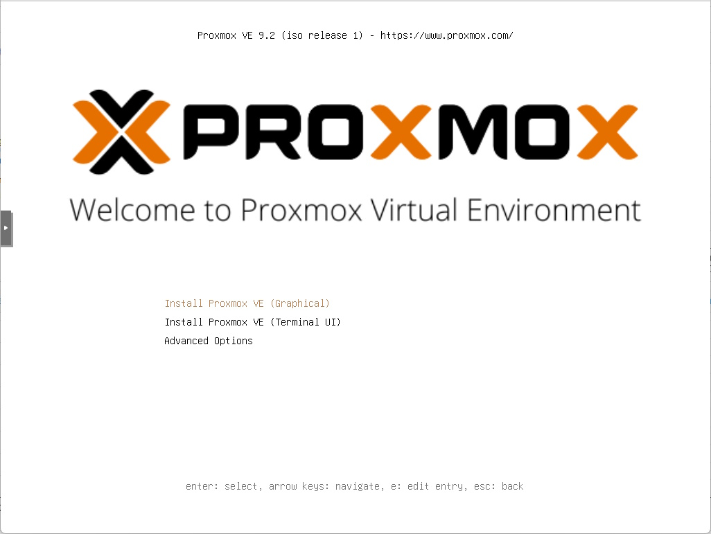

Viene consigliato di selezionare **Install Proxmox VE (Graphical)**
 
### 4.1 — Accettazione della licenza

La prima schermata mostra la licenza AGPL. Si accetta e si va avanti.

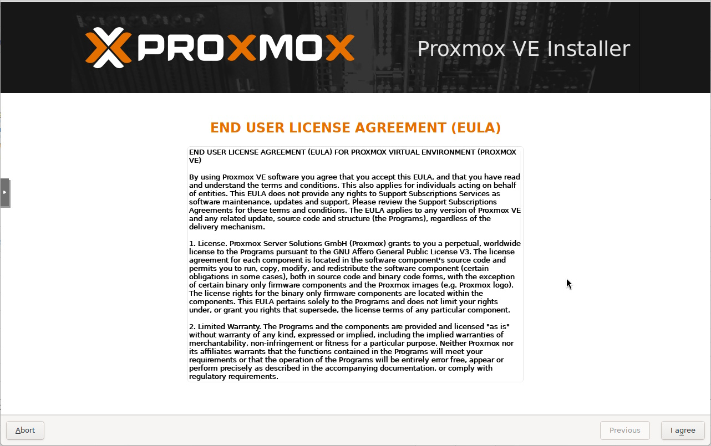


### 4.2 — Selezione del disco di destinazione

Dal momento che esiste un solo disco sul ThinkCentre, viene proposto quello con filesystem **ext4** e allo stato attuale mi va bene così. Se fossero presenti più dischi, in questa schermata sarebbe possibile scegliere anche una configurazione RAID con filesystem **ZFS**.

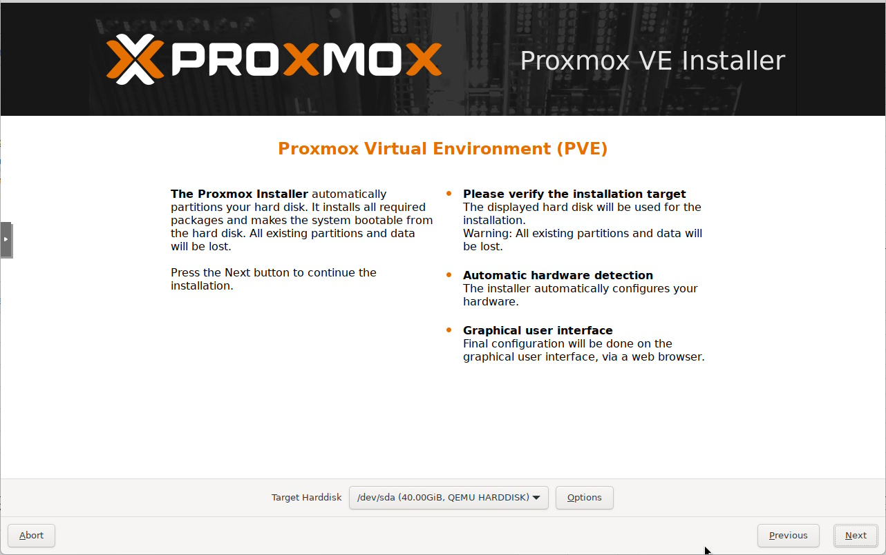


### 4.3 — Impostazioni geografiche

Mi vengono proposti dei parametri di default per paese (Italy), fuso orario (Europe/Rome) e layout della tastiera (Italian). Mi vanno bene così.

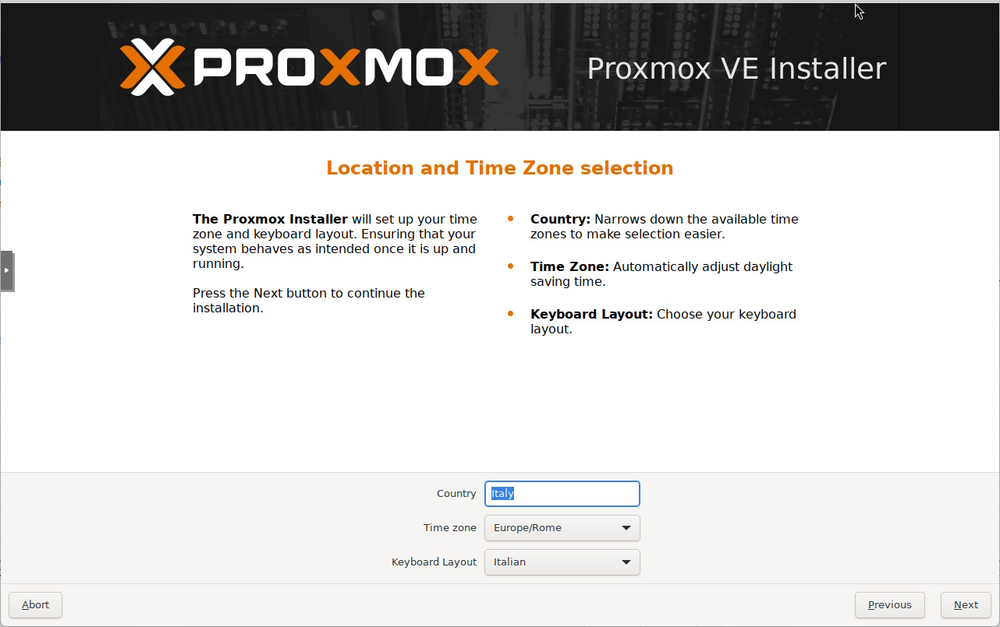


### 4.4 — Password e indirizzo email
Ho impostato la password per l'utente `root` e inserito un indirizzo email (usato per le notifiche di sistema).

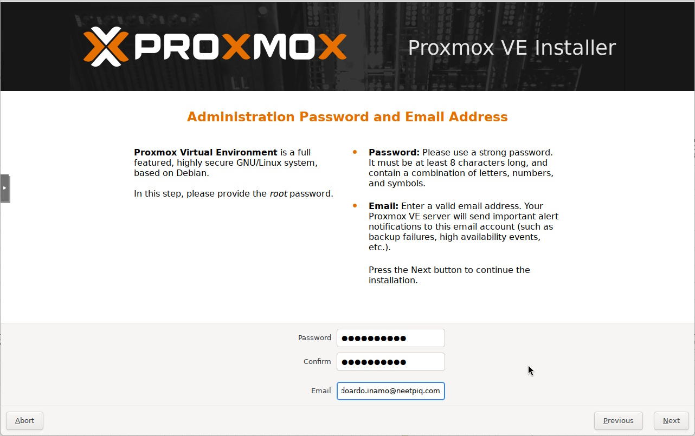


### 4.5 — Configurazione della rete
Questa è una fase cruciale. In quanto nodo importante all'interno della propria LAN è necessario utilizzare un indirizzo IP statico in modo che l'indirizzo IP di ogni nodo Proxmox sia sempre lo stesso.

Ecco quindi la mia configurazione:
 
- **Interfaccia di rete:** `vmbr0` (bridge virtuale creato automaticamente da Proxmox)
- **Indirizzo IP:** un IP statico sulla mia rete locale (es. `192.168.1.25/24`)
- **Gateway:** l'indirizzo del mio router (es. `192.168.1.1`)
- **DNS:** ho usato `192.168.1.1` come server DNS primario

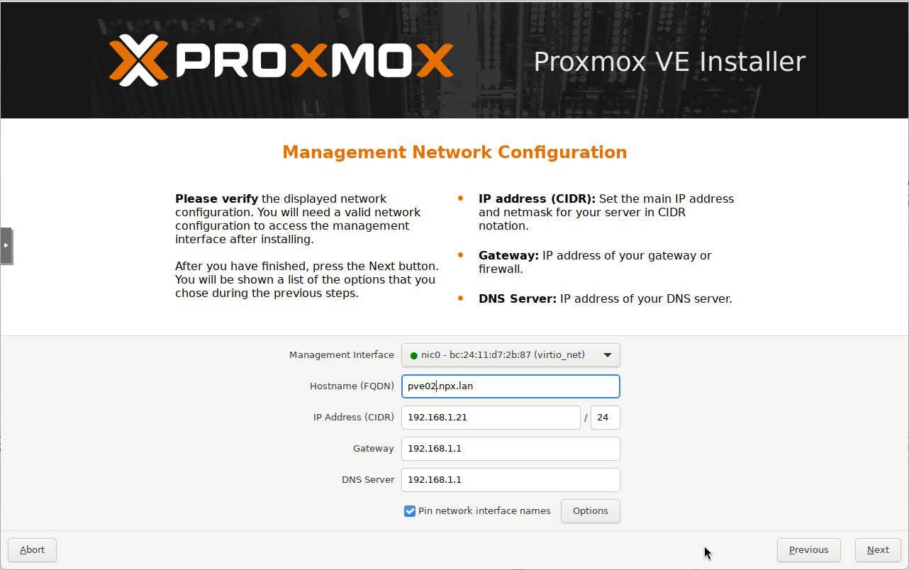


### 4.6 — Riepilogo e installazione
Dopo aver verificato il riepilogo, ho cliccato su **Install**. L'installazione ha impiegato circa 10 minuti. Al termine, il sistema si riavvia automaticamente (ricordarsi di rimuovere la chiavetta USB).

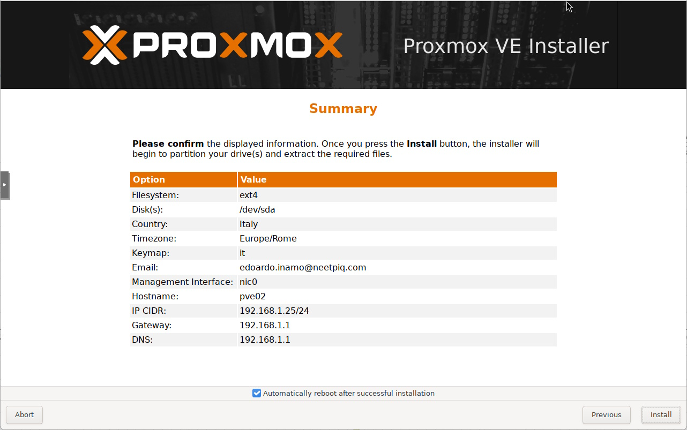
 
 
## Step 5 — Accesso all'interfaccia web
 
Dopo il riavvio, Proxmox è operativo. Per accedere all'interfaccia di gestione web si apre un browser su un qualsiasi dispositivo della stessa rete e si va all'indirizzo:
 
```
https://192.168.1.25:8006
```
 
> ⚠️ Il browser mostrerà un avviso di certificato SSL non valido (certificato self-signed): è normale, si può procedere cliccando su "Avanzate" → "Vai al sito".
 
Le credenziali di accesso sono:
- **Username:** `root`
- **Password:** quella impostata durante l'installazione
- **Realm:** `Linux PAM standard authentication`

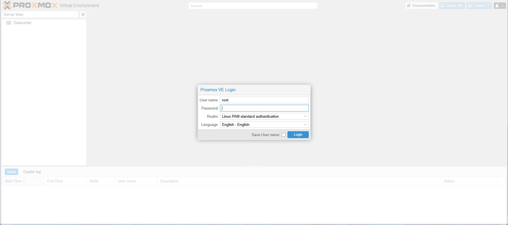

 
## Step 6 — Configurazione post-installazione
 
Una volta dentro la web UI, ho eseguito alcune operazioni consigliate:
 
### Disabilitare il repository Enterprise
 
Proxmox di default punta al repository Enterprise, che richiede un abbonamento. Per chi usa Proxmox in modo non commerciale, conviene abilitare il repository **No-Subscription** e disabilitare quello enterprise.

In particolare va aggiunto il repository per **pve-no-subscription** e disabilitato quello **pve-enterprise**.

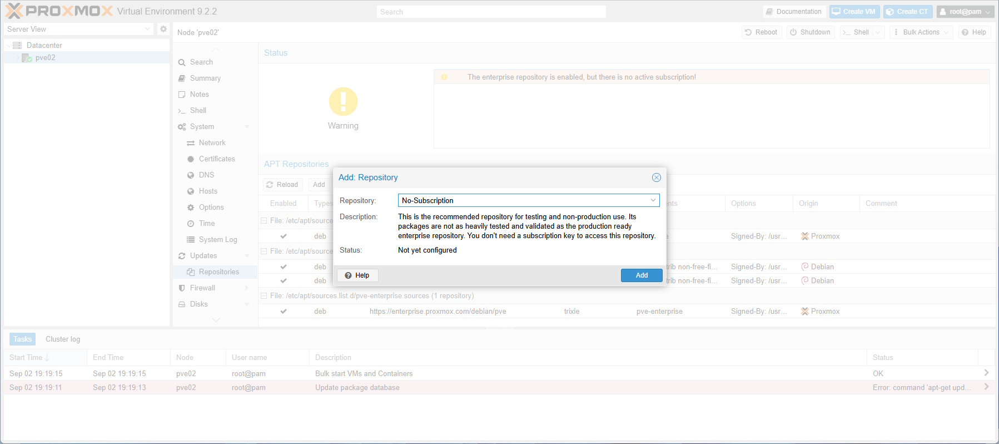


Successivamente va effettuata anche l'aggiunta del repository **Ceph Squid No-Subscription** e disabilitato quello enterprise.

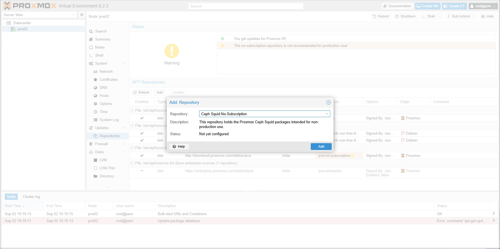

 
### Aggiornare il sistema
 
A questo punto è possibile lanciare l'upgrade del sistema. Dal menu **Updates** selezionare il pulsante **>_ Upgrade** che apre una finestra di console che chiede conferma per far partire l'upgrade.

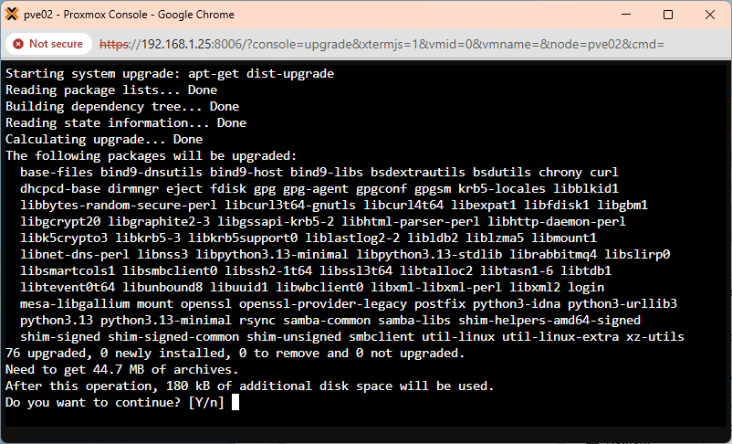
 

## Conclusioni
 
Anche l'installazione di Proxmox VE 9.2 sul Lenovo ThinkCentre M900 Tiny è andata bene e senza particolari problemi.

Per realizzare gli screenshot dell'installazione di Proxmox ho utilizzato una macchina virtuale `pve-demo` nella quale ho installato Proxmox provando in pratica una [virtualizzazione annidata](https://pve.proxmox.com/wiki/Nested_Virtualization).

Allo stato attuale la vm `pve-demo` verrà successivamente eliminata o spenta in quanto non intendo indagare ulteriormente sulla virtualizzazione annidata.

Prossimamente inizierò ad installare vari servizi principalmente come container LXC.

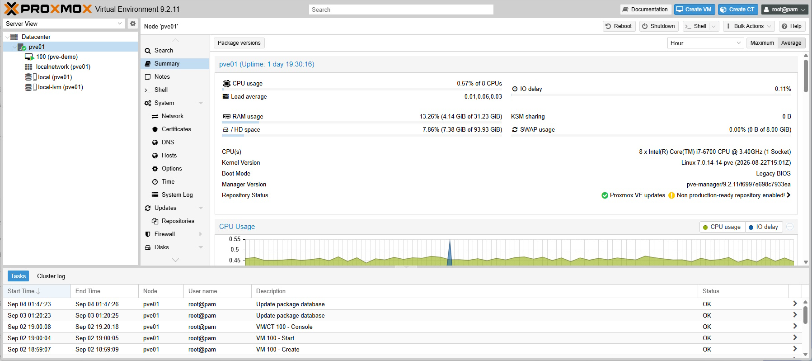


## Risorse utili

Come prima risorsa è giusto citare la [documentazione ufficiale sull'installazione](https://pve.proxmox.com/pve-docs/chapter-pve-installation.html).

Ma come risorsa molto valida e per giunta in italiano direi che questo video di [ArcoBit PC mania](https://www.youtube.com/@ArcoBitPCmania/videos) si è rivelato utile sia nella precedente installazione della versione 8.x che nell'installazione corrente della versione 9.2.

Proxmox Virtual Environment - installazione e configurazione by ArcoBit PC mania

Me sono guardato e riguardato più volte prima di iniziare la mia prima installazione della 8.x e anche della 9.2 perchè erano trascorsi un paio d'anni e non mi ricordavo più nulla.

ooOOoo