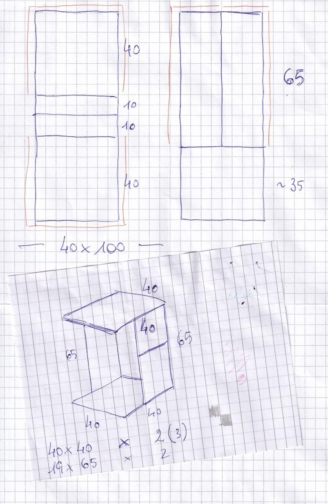
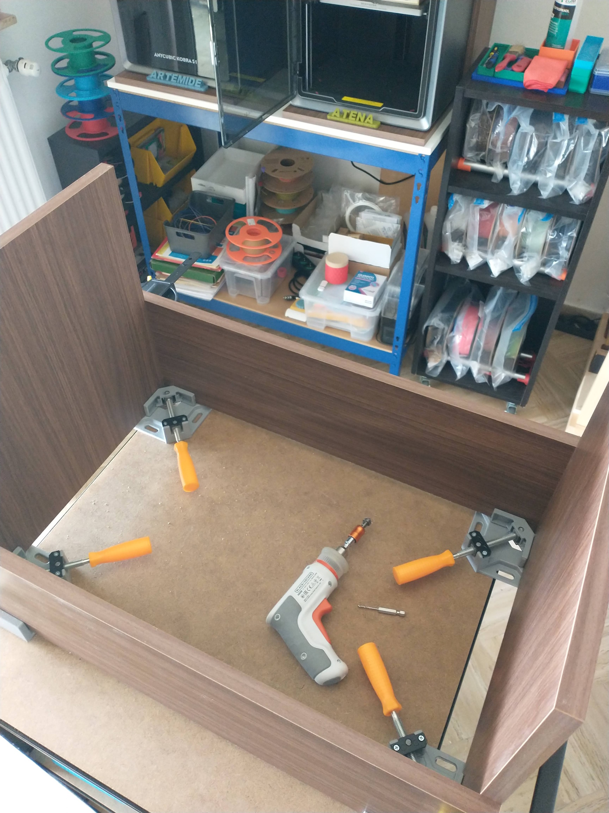
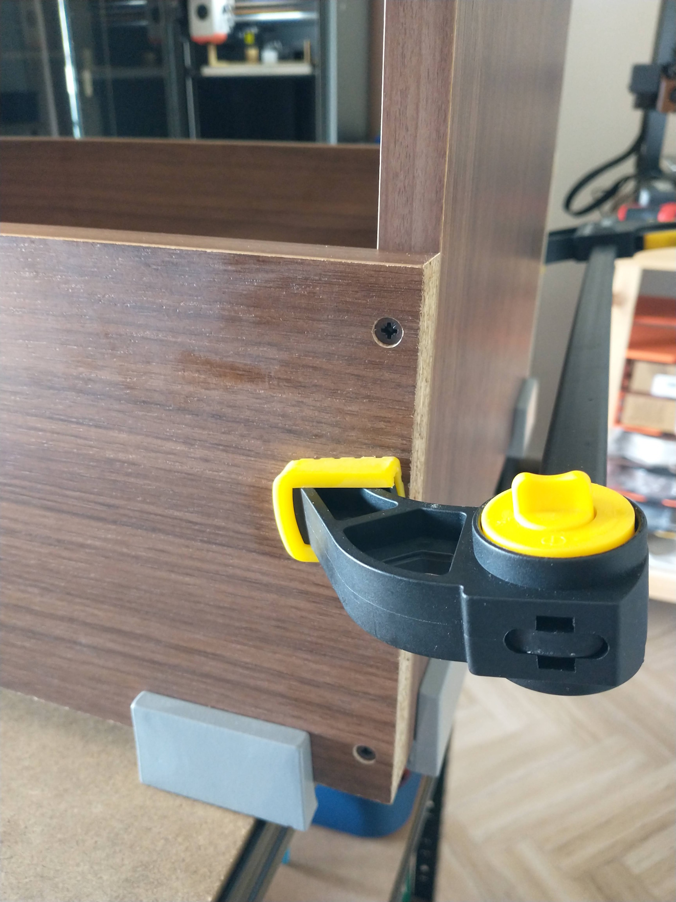
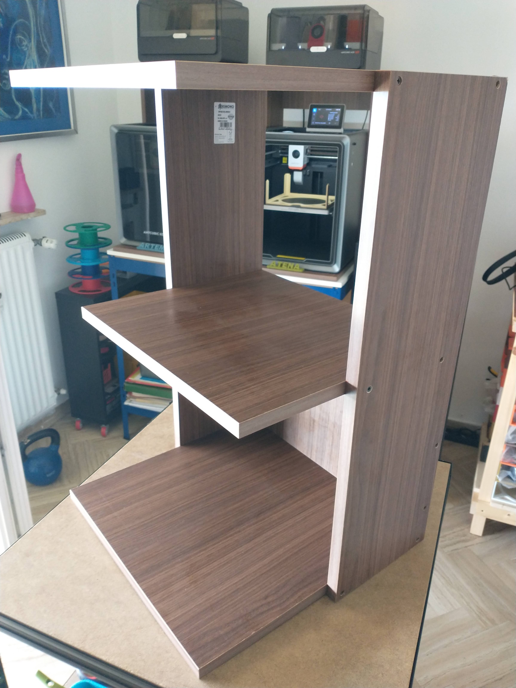
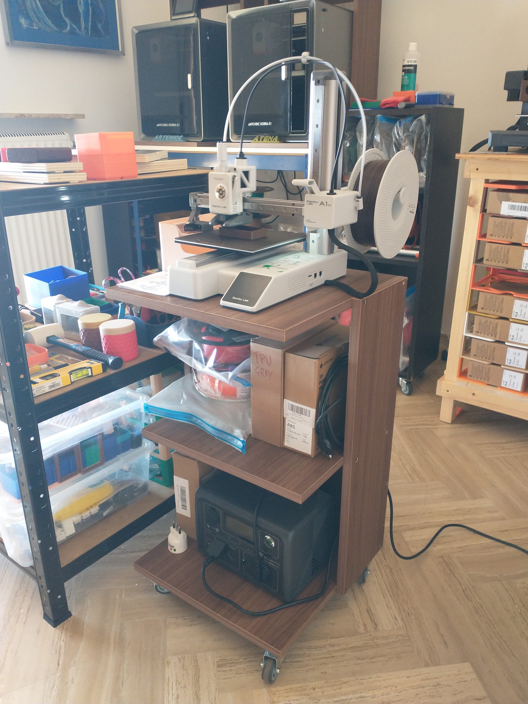

The Bambu Lab A1 mini is truly a gem of a printer. Although it has a small print area (180x180x180 mm), it is a very precise printer and very easy to use.

So I decided to build a small cabinet to place it on, one that would have space to store the filament spools.

## The project

I started with a small sketch on paper, which, for now, remains the quickest method for me when it comes to projects of this scale. Then I went to the BricoFer store near my house, bought two 40x100 cm panels of laminated particleboard, and had them cut so that the edge banding would be visible once assembled.

## Working on

With the pieces cut to size, I began assembly. I used angle clamps and a quick-release clamp to hold the cabinet sides in place.

And finally, I assembled the remaining piece—even though it was shorter than the pieces at the bottom and top—to create a shelf in the middle of the cabinet.

## Completed

Finally, my Bambulab A1 Mini has its own cabinet with wheels so I can move it around the house.

And I also added a sort of UPS using a [Bluetti EB3A 600W (1200W peak)](https://it.bluettipower.eu/products/bluetti-eb3a) that I can disconnect from the mains so I can move the printer around the house while keeping it powered.

As you can see, I'm quite fond of this type of structure, which I also used to build the enclosures for the two Anycubic Kobra S1 Combo printers.

ooOOoo