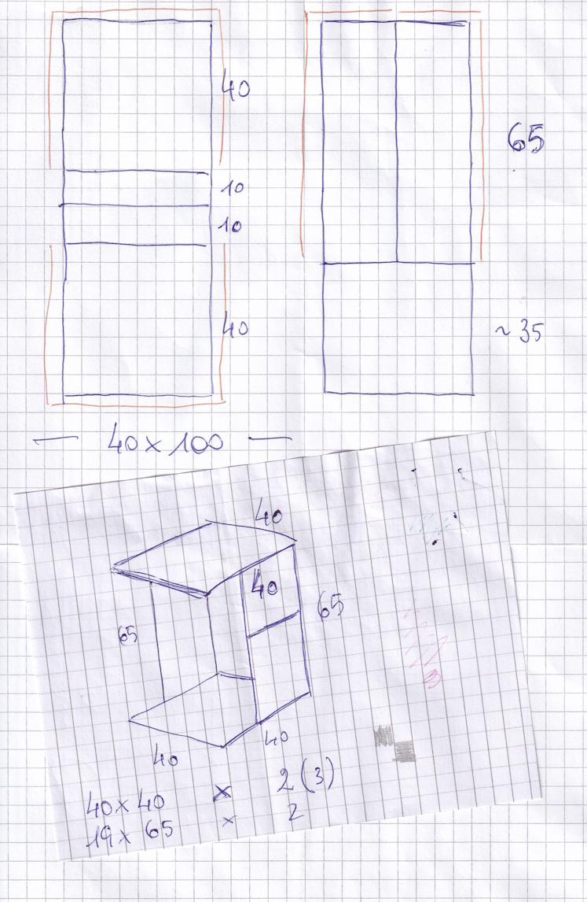
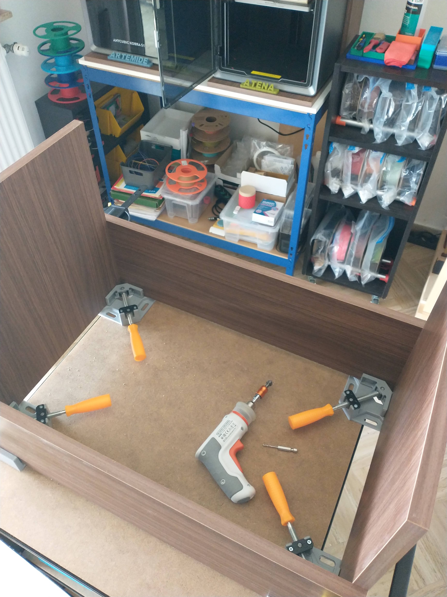
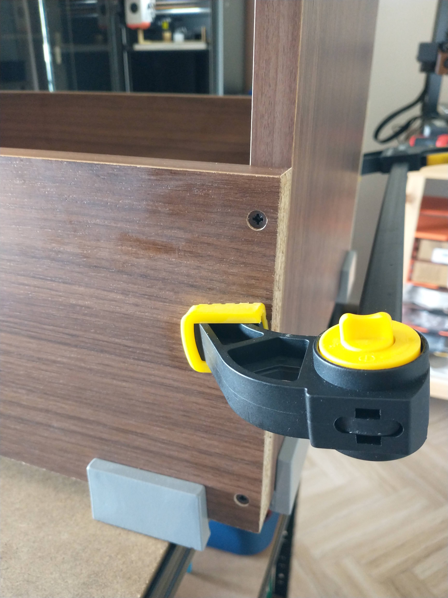
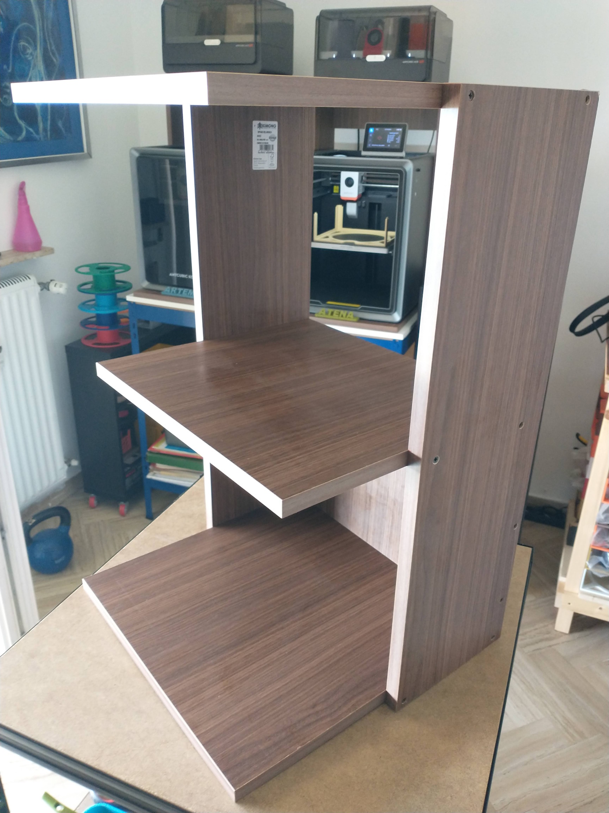
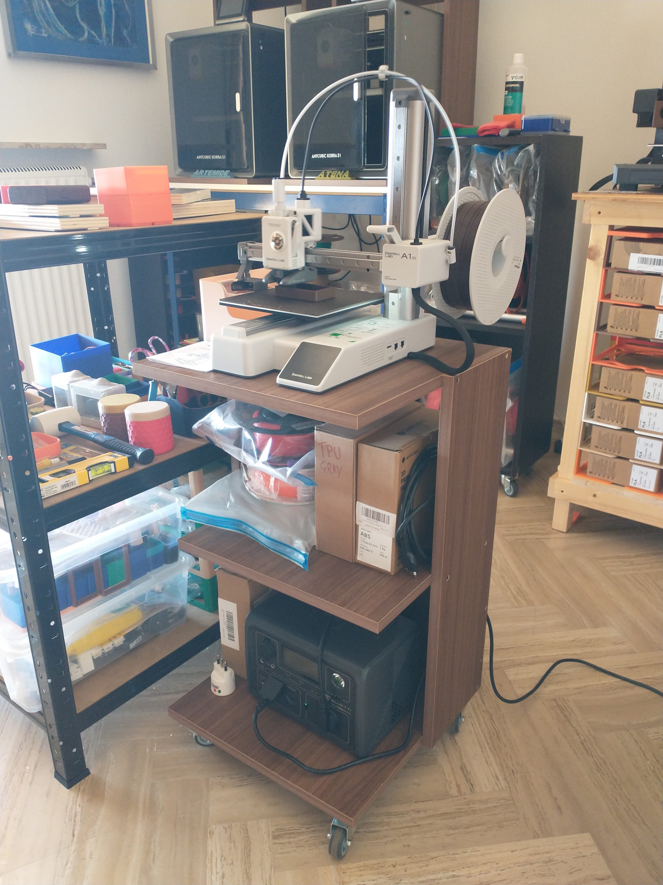

La Bambu Lab A1 mini è veramente un gioiellino di stampante. Nonostante abbia un'area di stampa ridotta (180x180x180mm), è una stampante molto precisa e molto facile da utilizzare.

Ho pensato quindi di realizzare un mobiletto sul quale posarla e che avesse dello spazio per contenere le bobine di filamento.

## Il progetto

Sono partito da un progettino su carta, che per ora rimane il sistema più rapido per me per creazioni di questa entità. Poi sono andato al BricoFer che ho vicino a casa, ho acquistato due pannelli di trucciolare rivestito da 40x100cm e li ho fatti tagliare in modo che una volta montato la bordatura fosse visibile.

## In construzione

Con i pezzi tagliati di misura ho iniziato il montaggio. Ho utilizzato dei morsetti ad angolo e un morsetto a sgancio rapido per tenere fermi i fianchetti del mobiletto.

E infine ho montato il pezzo che mi era rimasto, anche se più corto dei pezzi alla base e alla sommità, per avere un ripiano nella parte centrale del mobiletto.

## Completato

Finalmente la mia Bambulab A1 Mini ha il suo mobiletto con le rotelle per poterla portare in giro per casa.

E ho anche aggiunto una sorta di UPS utilizzando un [Bluetti EB3A da 600W (1200W Picco)](https://it.bluettipower.eu/products/bluetti-eb3a) che posso staccare dalla rete per portare la stampante in giro per la casa rimanendo alimentata.

Come si può notare sono affezionato a questo tipo di struttura che ho utilizzato anche per realizzare il contenitori delle due Anycubic Kobra S1 Combo.

ooOOoo